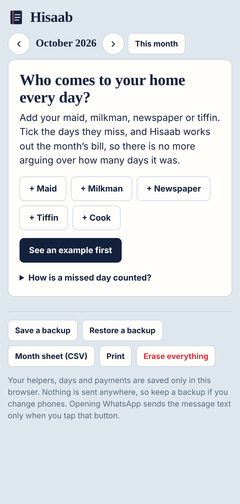
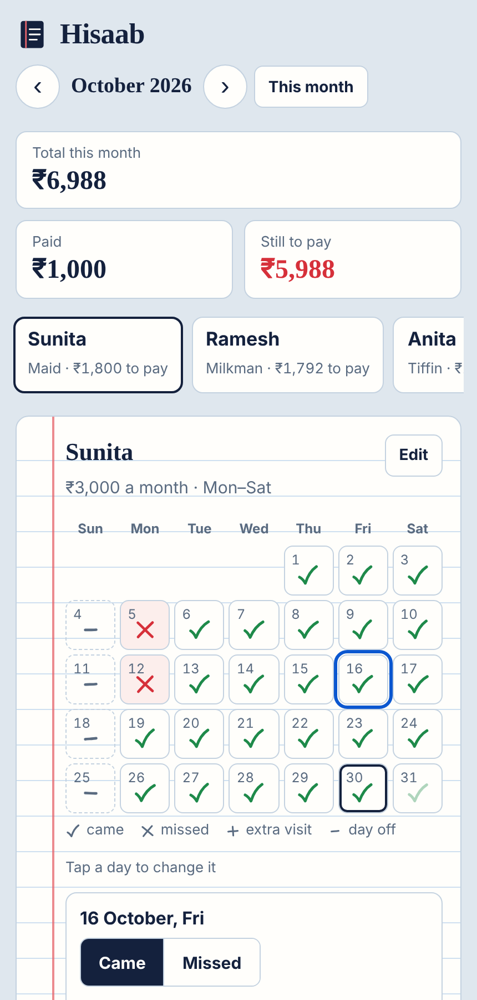
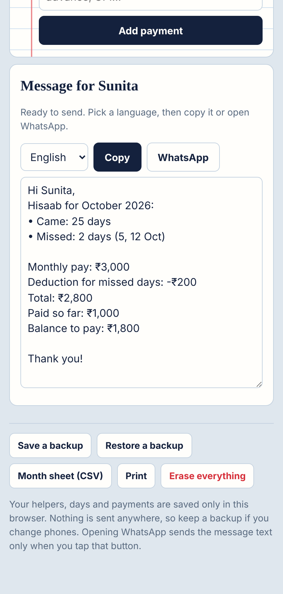

# Hisaab

Monthly hisaab for the people who come to your home: the maid, the milkman, the newspaper, the tiffin. Tick the days they miss, and Hisaab works out the month's bill, so there is no more arguing over how many days it was.

**Try it:** https://jay-m007.github.io/hisaab/

| Start | The month | The bill and message |
|---|---|---|
|  |  |  |

## What it does

- **Three kinds of pay.** A fixed monthly salary (maid, cook, driver), a flat amount for each day they come (tiffin, newspaper), or a rate times a quantity (milk by the litre).
- **A calendar you tick.** Everyone is assumed to have come on their usual days. Tap a day to mark it missed, add an extra visit on a day off, or change the quantity of milk.
- **Fair deductions.** For a monthly salary, a missed day is worth one thirtieth of the pay. You can change that to the days in the month or the days they should come.
- **Rate changes.** Milk goes up on the 16th: days before keep the old rate, days after use the new one. A monthly salary change is prorated by day.
- **Payments.** Note advances and part payments. The bill shows what is still to pay, or what was paid in advance.
- **A message to send.** English, Hinglish or हिन्दी, with the days missed, the deduction and the balance. Copy it or open WhatsApp.
- **Yours to keep.** Month sheet as CSV, full backup and restore as JSON, and a print view.

## Privacy

Everything runs in your browser and is saved only on your device. There is no server, no account and no tracking, and the page's security policy blocks all network requests. The one exception is the WhatsApp button: when you tap it, the message text is passed to WhatsApp. Because nothing is stored elsewhere, keep a backup if you change phones or clear your browser data.

## How the numbers work

All money is stored as whole paise, so totals never drift. Dates are plain `YYYY-MM-DD` strings, so there are no time zone surprises. The calculation lives in `engine/` with no dependencies and is covered by tests, including month edges, leap years, mid-month rate changes and bad backup files.

```
engine/   bill.js (the maths), message.js, model.js (saved data), export.js, money.js, dates.js
web/      the page: index.html, style.css, app.js
tests/    node --test
```

## Run it yourself

```
npm test          # 22 tests
npm run serve     # builds, then open http://localhost:8080
```

No build tools or packages to install; it needs Node 20 or newer. Pushing to `main` runs the tests and publishes the site with GitHub Pages.

## Licence

MIT
